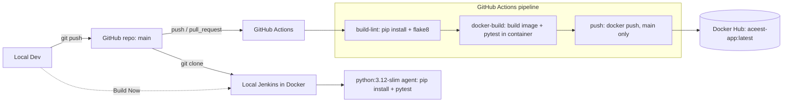

# ACEest Fitness & Gym - DevOps CI/CD Pipeline

A Flask web application for managing gym clients, wrapped in a complete DevOps lifecycle:
Git version control, Pytest unit tests, Docker containerisation, a GitHub Actions CI/CD
pipeline that publishes an image to Docker Hub, and a local Jenkins build quality gate.

The application is a web port of the original ACEest tkinter desktop app (versions 2.1.2 and 2.2.4).

## Project Overview

**Application features**

| Feature | Route |
|---|---|
| Client list | `GET /` |
| Create client | `GET/POST /clients/new` |
| Client profile (with weekly progress) | `GET /clients/<name>` |
| Edit client | `GET/POST /clients/<name>/edit` |
| Log weekly adherence | `POST /clients/<name>/progress` |
| Log / view workouts | `GET/POST /clients/<name>/workouts` |
| Health check | `GET /health` returns `{"status": "ok"}` |

Daily calories are calculated as `weight (kg) x program factor`:

| Program | Factor |
|---|---|
| Fat Loss (FL) - 3 day | 22 |
| Fat Loss (FL) - 5 day | 24 |
| Muscle Gain (MG) - PPL | 35 |
| Beginner (BG) | 26 |

**Persistence:** SQLite (`instance/aceest_fitness.db`), created with `flask init-db` from `schema.sql`
(tables `clients`, `progress`, `workouts`).

**Pinned versions (hard constraints)**

| Component | Version |
|---|---|
| Python (Docker, CI, Jenkins) | 3.12 (`python:3.12-slim`) |
| Flask | 3.1.3 |
| pytest | 8.4.2 |

`requirements.txt` contains exactly `Flask==3.1.3` and `pytest==8.4.2`. The Dockerfile, the GitHub
Actions workflow and the Jenkinsfile all install from it, so no other versions are used. flake8 is
installed only inside the lint step of the workflow.

## Architecture



## Prerequisites

- Python 3.12 (3.11+ should work locally, CI uses 3.12)
- Git
- Docker (Docker Desktop on Windows needs WSL2 or Hyper-V)
- Optional: a Docker Hub account, to publish images

## Local Setup & Execution

```bash
git clone https://github.com/mananshori98/aceest-devops.git
cd aceest-devops

python -m venv .venv
# Windows: .venv\Scripts\activate      Linux/macOS: source .venv/bin/activate
pip install -r requirements.txt

flask init-db      # creates instance/aceest_fitness.db from schema.sql
flask run          # http://127.0.0.1:5000
```

On Windows, if `python` opens the Microsoft Store, use `py` instead.

## Running Tests Manually

```bash
pytest --tb=short
```

The suite has 19 tests covering client create/edit/profile, calorie calculation, weekly progress,
workout logging and the health endpoint. Each test uses its own temporary SQLite database, so tests
never touch the real data.

To lint as the pipeline does:

```bash
pip install flake8==7.2.0
flake8 app.py tests/
```

## Docker

```bash
docker build -t aceest-app .
docker run -p 5000:5000 aceest-app
```

Then open http://localhost:5000 (health: http://localhost:5000/health).

- Base image `python:3.12-slim`; dependencies are installed in a separate layer for build caching.
- The app runs as the non-root user `appuser`.
- A `HEALTHCHECK` calls `/health` (`docker ps` shows `healthy`).
- The container runs `flask init-db` and then `flask run`. The database lives inside the container,
  so it is reset when the container is removed. Mount a volume at `/app/instance` to keep data.
- `tests/` is intentionally kept in the image so CI can run `docker run aceest-app pytest`.

Run the published image (replace `<user>` with the Docker Hub username):

```bash
docker run -p 5000:5000 <user>/aceest-app:latest
```

## GitHub Actions Pipeline

Defined in `.github/workflows/main.yml`. It runs on every `push` and `pull_request` to `main`.

| Job | Runs | What it does |
|---|---|---|
| `build-lint` | always | Checkout, Python 3.12, `pip install -r requirements.txt`, `flake8 app.py tests/` |
| `docker-build` | after `build-lint` | `docker build -t aceest-app .`, then `docker run --rm aceest-app pytest --tb=short` |
| `push` | after `docker-build`, only on `push` to `main` | Log in to Docker Hub, tag and push `<user>/aceest-app:latest` |

Pull requests run the first two jobs only, so nothing is published from a PR.

### Secrets

Add these under the repository's Settings > Secrets and variables > Actions > Repository secrets:

| Secret | Value |
|---|---|
| `DOCKER_USERNAME` | Your Docker Hub username |
| `DOCKER_PASSWORD` | A Docker Hub access token (Account Settings > Security > New Access Token, Read & Write) |

Use an access token rather than your account password, and never commit credentials to the repo.

## Jenkins BUILD Setup

Jenkins is an independent quality gate that clones the repository and runs the `Jenkinsfile`
(install from `requirements.txt`, then `pytest`) inside a `python:3.12-slim` container.

1. Build the Jenkins image. It adds the Docker CLI and the Git, Pipeline and Docker Pipeline plugins
   to `jenkins/jenkins:lts-jdk17` and skips the setup wizard:

   ```bash
   docker build -t aceest-jenkins ./jenkins
   ```

2. Start Jenkins. The Docker socket is mounted so Jenkins can start the Python build container:

   ```bash
   docker run -d --name jenkins -u root \
     -p 8080:8080 -p 50000:50000 \
     -v jenkins_home:/var/jenkins_home \
     -v /var/run/docker.sock:/var/run/docker.sock \
     aceest-jenkins
   ```

3. Open http://localhost:8080.
4. Create the job (either way):
   - In the UI: New Item > name `ACEest-Build` > **Pipeline** > Definition **Pipeline script from SCM** >
     SCM **Git** > Repository URL `https://github.com/mananshori98/aceest-devops.git` >
     Branch `*/main` > Script Path `Jenkinsfile` > Save.
   - Or copy the saved definition and restart:

     ```bash
     docker exec jenkins mkdir -p /var/jenkins_home/jobs/ACEest-Build
     docker cp jenkins/ACEest-Build.xml jenkins:/var/jenkins_home/jobs/ACEest-Build/config.xml
     docker restart jenkins
     ```

5. Click **Build Now**. The console output should show Flask 3.1.3, pytest 8.4.2, Python 3.12 and
   `19 passed`, ending with `Finished: SUCCESS`.

Notes:
- The job is a Pipeline job (not Freestyle) because the `Jenkinsfile` uses a Docker agent.
- On Windows with Docker Desktop, `-v /var/run/docker.sock:/var/run/docker.sock` works with the
  WSL2 backend. In PowerShell write the command on one line (replace `\` line breaks).
- This Jenkins has no login. It is for local use only, so do not expose port 8080.

## Project Structure

```
.
├── app.py                      Flask application
├── schema.sql                  SQLite schema
├── requirements.txt            Flask==3.1.3, pytest==8.4.2
├── Dockerfile                  python:3.12-slim image
├── Jenkinsfile                 Jenkins pipeline
├── jenkins/                    Local Jenkins image + job definition
├── templates/                  Jinja2 + Bootstrap templates
├── tests/                      Pytest suite
└── .github/workflows/main.yml  GitHub Actions pipeline
```

## Troubleshooting

| Symptom | Cause / fix |
|---|---|
| `push` job fails at Docker login | `DOCKER_USERNAME` / `DOCKER_PASSWORD` secrets are missing or misnamed |
| Container shows `unhealthy` | The image needs `curl` (installed in the Dockerfile); check `docker logs <container>` |
| Docker Desktop will not start on Windows | Install WSL2 (`wsl --install`) and restart |
| Jenkins build cannot run Docker | Make sure the Docker socket is mounted and the container runs as `root` |
| `python` opens the Microsoft Store | Use `py`, or disable the App execution alias |
