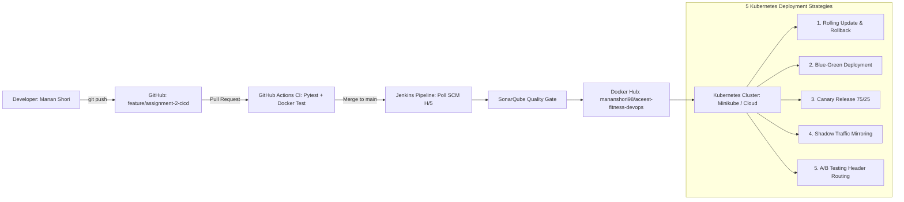

# ACEest Fitness & Gym — DevOps Assignment 2

**Student Name:** Manan Shori  
**Roll Number:** 2025TM93143  
**BITS Email:** 2025TM93143@wilp.bits-pilani.ac.in  
**GitHub Repository:** [https://github.com/mananshori98/aceest-devops](https://github.com/mananshori98/aceest-devops)  
**Docker Hub Repository:** [https://hub.docker.com/r/mananshori98/aceest-fitness-devops](https://hub.docker.com/r/mananshori98/aceest-fitness-devops)  
**Application Version:** `2.0.0`  

This repository implements a production-grade, end-to-end automated Continuous Integration and Continuous Delivery (CI/CD) workflow for the ACEest Fitness & Gym Flask API.

---

## Architecture Overview



---

## Application Endpoints (`v2.0.0`)

| Route | Method | Purpose | Response |
| :--- | :---: | :--- | :--- |
| `/` | `GET` | API Information & Status | `{"application": "ACEest Fitness & Gym", "version": "2.0.0", "status": "running"}` |
| `/health` | `GET` | Liveness Probe | `{"status": "healthy", "version": "2.0.0"}` |
| `/ready` | `GET` | Readiness Probe | `{"status": "ready", "version": "2.0.0"}` |
| `/version` | `GET` | Version Introspection | `{"application": "ACEest Fitness & Gym", "version": "2.0.0"}` |
| `/programs` | `GET` | Available Fitness Programs | JSON array of programs |
| `/clients` | `GET` | List All Clients | JSON array of client records |
| `/clients` | `POST` | Register Client | JSON client object (409 on duplicate email) |
| `/calories` | `POST` | Calculate Calorie Burn | JSON calorie estimate based on weight, duration, intensity |
| `/progress` | `GET` / `POST` | Client Progress Tracking | JSON progress records |
| `/workouts` | `GET` / `POST` | Workout Logging | JSON workout records |
| `/metrics` | `POST` | Body Metrics & BMI | JSON body metric with calculated BMI |

---

## Validation & Code Quality

- **Unit Tests:** 20 automated Pytest test cases.
- **Code Coverage:** >85% application code coverage.
- **Static Analysis:** SonarQube Quality Gate **PASSED** (0 bugs, 0 vulnerabilities, 0 security hotspots).
- **CI Pipelines:** GitHub Actions workflow (`.github/workflows/main.yml`) + Jenkins Declarative Pipeline (`Jenkinsfile`).

---

## Git Workflow & Tagging

- **Assignment 1 Baseline Tag:** `assignment-1-final`
- **Feature Branch:** `feature/assignment-2-cicd`
- **Release Tag:** `assignment-2-v2.0.0`
- **Pull Request:** Merged into `main` after all automated CI status checks pass.

---

## Container Registry

Public Docker Hub repository:
`mananshori98/aceest-fitness-devops`

Published image tags:
- `v1.0.0` (Baseline release)
- `v2.0.0` (Assignment 2 release)
- `latest` (Points to `v2.0.0`)

---

## Local Setup & Test Execution

```powershell
# Create and activate virtual environment
python -m venv .venv
.venv\Scripts\activate   # Linux/macOS: source .venv/bin/activate

# Install dependencies
pip install -r requirements.txt

# Validate syntax
python -m py_compile app.py

# Run Pytest with coverage
pytest -q --cov=app --cov-report=term --cov-report=xml
```

---

## Docker Execution

```powershell
# Build Docker image
docker build -t mananshori98/aceest-fitness-devops:v2.0.0 .

# Run tests inside container
docker run --rm mananshori98/aceest-fitness-devops:v2.0.0 python -m pytest -q

# Run containerized application
docker run -d --name aceest-fitness -p 5000:5000 mananshori98/aceest-fitness-devops:v2.0.0
```

---

## Kubernetes Deployment Strategies (`kubernetes/`)

1. **Rolling Update & Rollback (`base.yaml`):** Zero-downtime rolling update with `maxUnavailable: 0` and `maxSurge: 1`. Rollback verified with `kubectl rollout undo`.
2. **Blue-Green Deployment (`blue-green.yaml`):** Parallel deployments with instantaneous service selector switching.
3. **Canary Release (`canary.yaml`):** 3:1 replica ratio routing 25% traffic to Canary (`v2.0.0`) and 75% to Stable (`v1.0.0`).
4. **Shadow Deployment (`shadow.yaml`):** Ingress traffic mirroring via `nginx.ingress.kubernetes.io/mirror-target`.
5. **A/B Testing (`ab-testing.yaml`):** Ingress header routing using `X-ACEEST-Version: B`.

---

## Project Structure

```
aceest-devops/
├── app.py                      Flask REST application (v2.0.0)
├── Dockerfile                  Container definition (python:3.12-slim)
├── Jenkinsfile                 8-stage Jenkins declarative pipeline
├── sonar-project.properties    SonarQube project configuration
├── requirements.txt            Pinned Python dependencies
├── assignment-2-plan.md        Detailed implementation plan
├── .github/
│   └── workflows/
│       └── main.yml            GitHub Actions CI workflow
├── tests/
│   └── test_app.py             20 Pytest unit tests (>=85% coverage)
├── kubernetes/
│   ├── base.yaml               Rolling update and rollback manifests
│   ├── blue-green.yaml         Blue-Green deployment manifests
│   ├── canary.yaml             Canary release manifests
│   ├── shadow.yaml             Shadow traffic mirroring manifests
│   └── ab-testing.yaml         A/B testing header routing manifests
├── reports/
│   ├── sonarqube-summary.txt   SonarQube Quality Gate report
│   └── prayogshala-deployment-summary.txt Cluster endpoint summary
└── Evidence/
    └── evidence-index.md       Evidence screenshot mapping table
```
