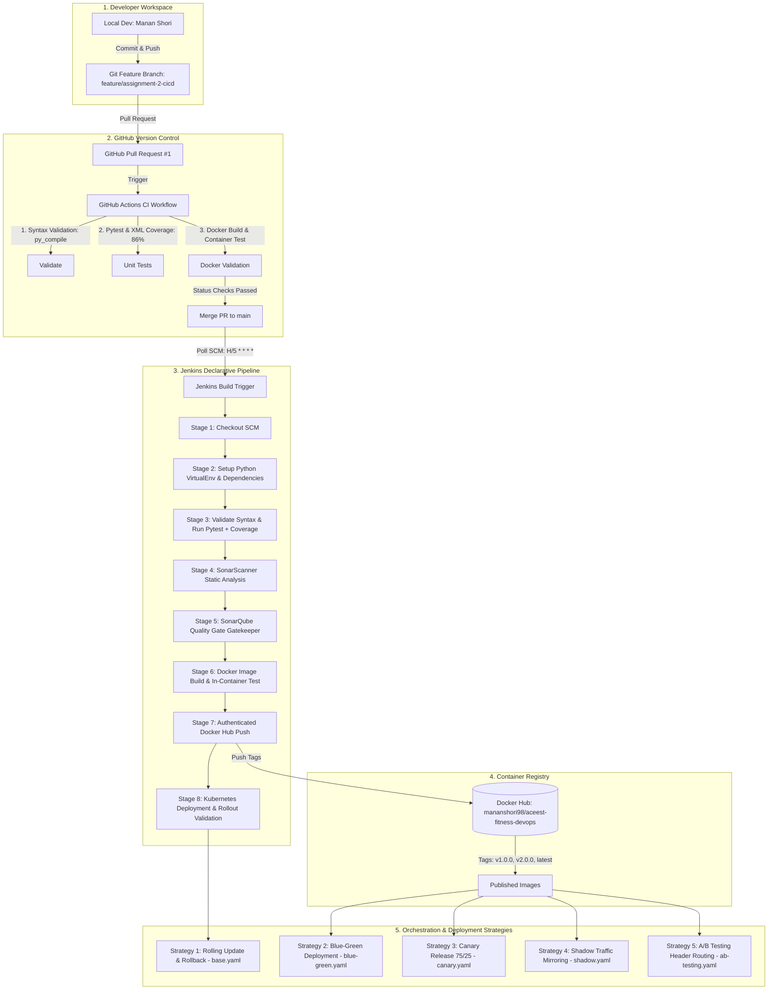

# ACEest Fitness & Gym — DevOps Assignment 2 Comprehensive Implementation Plan

**Student Name:** Manan Shori  
**Roll Number:** 2025TM93143  
**BITS Email:** 2025TM93143@wilp.bits-pilani.ac.in  
**GitHub Username:** mananshori98  
**GitHub Repository:** [https://github.com/mananshori98/aceest-devops](https://github.com/mananshori98/aceest-devops)  
**Docker Hub Repository:** `mananshori98/aceest-fitness-devops`  
**Application Version:** `2.0.0` (Release Tag: `assignment-2-v2.0.0`)  

---

## 1. Executive Summary & Objectives

The goal of Assignment 2 is to transform the foundational ACEest Fitness & Gym application into an enterprise-grade automated CI/CD ecosystem. Building upon the Assignment 1 baseline, this assignment delivers:
- Comprehensive RESTful Flask API (`v2.0.0`) with 100% JSON compliance, health probes, calorie calculations, workout tracking, and body metrics.
- 20+ automated Pytest test cases achieving >85% code coverage.
- Dual CI automation: GitHub Actions for PR/commit validation and a multi-stage Jenkins Declarative Pipeline.
- Static code analysis with SonarQube enforcing strict Quality Gate policies (0 bugs, 0 vulnerabilities, >80% coverage).
- Automated Docker containerization and versioned publication to Docker Hub (`v1.0.0`, `v2.0.0`, `latest`).
- Kubernetes cluster orchestration demonstrating 5 progressive deployment strategies:
  1. Rolling Update & Zero-Downtime Rollback
  2. Blue-Green Deployment
  3. Canary Release
  4. Shadow Deployment (Traffic Mirroring)
  5. A/B Testing (Header-based Traffic Splitting)
- Full audit evidence documentation and academic summary report.

---

## 2. End-to-End Architectural Flow



---

## 3. Detailed Work Breakdown Structure (Phase-by-Phase)

### Phase 1: Application Evolution & Test Suite Enhancement
**Goal:** Deliver a production-grade, RESTful Flask API (`v2.0.0`) with complete endpoint coverage and robust validation.

1. **Application Code (`app.py`):**
   - Application version constant: `APP_VERSION = "2.0.0"`.
   - Core endpoints:
     - `GET /`: API welcome banner, running status, and version.
     - `GET /health`: Liveness probe endpoint returning `{"status": "healthy", "version": "2.0.0"}`.
     - `GET /ready`: Readiness probe endpoint returning `{"status": "ready", "version": "2.0.0"}`.
     - `GET /version`: Dedicated version introspection endpoint.
     - `GET /programs`: Program listings (Weight Loss, Muscle Gain, General Fitness).
     - `GET /clients` & `POST /clients`: Client listing, registration with email uniqueness (409 on duplicate) and input validation (400 on malformed input).
     - `POST /calories`: Calorie expenditure calculator using weight, duration, and intensity factors (`low`: 0.05, `moderate`: 0.08, `high`: 0.11).
     - `GET /progress` & `POST /progress`: Progress recording tied to client ID.
     - `GET /workouts` & `POST /workouts`: Workout logging with duration validation.
     - `POST /metrics`: Body metrics logging with automated BMI calculation ($BMI = \frac{\text{weight\_kg}}{(\text{height\_m})^2}$).
     - Custom 404 JSON error handler.

2. **Automated Unit Testing (`tests/test_app.py`):**
   - Pytest fixtures with clean state isolation (`app.config['TESTING'] = True`).
   - 20 unit tests covering:
     - All status codes (`200`, `201`, `400`, `404`, `409`).
     - Calculation accuracy (calories and BMI).
     - Malformed JSON payloads, negative numbers, missing required parameters.
   - Code coverage target: $\ge 85\%$ line coverage with term and XML outputs.

3. **Dependency Pinning (`requirements.txt`):**
   - `Flask==3.1.3` (or compatible 3.x)
   - `pytest==8.4.2`
   - `pytest-cov==6.0.0`
   - `gunicorn==23.0.0`

---

### Phase 2: Git Version Control & Branching Workflow
**Goal:** Implement professional Git lifecycle practices with traceable branches, baseline tags, PR reviews, and release tags.

1. **Baseline Tagging:**
   - Tag initial Assignment 1 baseline commit as `assignment-1-final`.
2. **Branching Strategy:**
   - Create and checkout feature branch: `feature/assignment-2-cicd`.
   - Implement Assignment 2 code, tests, CI workflows, and Kubernetes manifests.
   - Stage, commit with clear descriptive messages (`feat: ...`, `ci: ...`, `docs: ...`).
3. **Pull Request & Merge:**
   - Push `feature/assignment-2-cicd` to GitHub.
   - Open Pull Request #1 targeting `main`.
   - Verify GitHub Actions CI status checks pass.
   - Merge Pull Request into `main`.
4. **Release Tagging:**
   - Create annotated release tag on `main`: `assignment-2-v2.0.0`.
   - Push all tags to remote: `git push origin --tags`.

---

### Phase 3: GitHub Actions CI Workflow Setup
**Goal:** Provide fast-feedback pull request validation before code enters `main`.

- **Workflow File:** `.github/workflows/main.yml`
- **Triggers:** `push` on `main` and `feature/assignment-2-cicd`, `pull_request` on `main`.
- **Job Pipeline Steps:**
  1. `actions/checkout@v4`
  2. `actions/setup-python@v5` with Python `3.12` and pip caching.
  3. Dependency installation: `pip install -r requirements.txt`.
  4. Syntax validation: `python -m py_compile app.py`.
  5. Test execution with coverage: `pytest -q --cov=app --cov-report=term --cov-report=xml`.
  6. Docker container build: `docker build -t aceest-fitness:${{ github.sha }} .`.
  7. In-container test execution: `docker run --rm aceest-fitness:${{ github.sha }} python -m pytest -q`.

---

### Phase 4: Containerization & Docker Hub Publishing
**Goal:** Build reproducible, secure Docker images and manage versions on Docker Hub.

1. **Dockerfile Specification:**
   - Base image: `python:3.12-slim`.
   - Non-root user execution (`appuser`) for security.
   - Healthcheck configuration targeting `/health`.
   - Dependencies pre-installed in distinct cache layer.
   - Expose port `5000`.
2. **Container Registry Organization:**
   - Public Docker Hub repository: `mananshori98/aceest-fitness-devops`
   - Published Image Tags:
     - `v1.0.0`: Assignment 1 / baseline image (used for Blue deployment and baseline testing).
     - `v2.0.0`: Assignment 2 release image.
     - `latest`: Points to current stable `v2.0.0`.
3. **Local Container Verification:**
   - Build image: `docker build -t mananshori98/aceest-fitness-devops:v2.0.0 .`
   - Test in container: `docker run --rm mananshori98/aceest-fitness-devops:v2.0.0 python -m pytest -q`
   - Run container and check `/health`, `/ready`, `/version`.

---

### Phase 5: Jenkins Declarative Pipeline & SonarQube Integration
**Goal:** Automate enterprise CI/CD execution with automated polling, code quality enforcement, and deployment.

1. **Jenkins Configuration:**
   - Poll SCM Schedule: `H/5 * * * *` (polls repository every 5 minutes).
   - Docker Hub credentials ID: `dockerhub-credentials`.
   - SonarScanner tool installation: `SonarScanner`.
   - SonarQube Server integration: `SonarQube`.

2. **SonarQube Configuration (`sonar-project.properties`):**
   ```properties
   sonar.projectKey=aceest-fitness-devops
   sonar.projectName=ACEest Fitness & Gym DevOps
   sonar.projectVersion=2.0.0
   sonar.sources=app.py
   sonar.tests=tests
   sonar.python.version=3.12
   sonar.python.coverage.reportPaths=coverage.xml
   ```

3. **Jenkins Pipeline Stages (`Jenkinsfile`):**
   - **Stage 1 (Checkout):** SCM checkout from Git.
   - **Stage 2 (Set Up Python):** Creation of isolated virtual environment `.venv`.
   - **Stage 3 (Validate and Test):** Syntax check (`py_compile`) + Pytest with `coverage.xml`.
   - **Stage 4 (SonarQube Analysis):** Execution of `sonar-scanner` within `withSonarQubeEnv`.
   - **Stage 5 (Quality Gate):** `waitForQualityGate` enforcing zero quality gate violations.
   - **Stage 6 (Build & Test Docker Image):** Docker build + in-container pytest validation.
   - **Stage 7 (Publish Docker Images):** Push `v2.0.0` and `latest` using `withCredentials`.
   - **Stage 8 (Deploy to Kubernetes):** `kubectl apply -f kubernetes/base.yaml` and rollout verification.

---

### Phase 6: Kubernetes Advanced Deployment Strategies
**Goal:** Implement and validate 5 progressive zero-downtime deployment strategies.

| Strategy | Manifest File | Key Technical Mechanics | Validation Criteria |
| :--- | :--- | :--- | :--- |
| **1. Rolling Update & Rollback** | `kubernetes/base.yaml` | `maxUnavailable: 0`, `maxSurge: 1`, Liveness/Readiness probes on `/health` and `/ready`. | Zero dropped requests during image upgrade (`v1.0.0` $\to$ `v2.0.0`); `kubectl rollout undo` successfully reverts to previous revision. |
| **2. Blue-Green Deployment** | `kubernetes/blue-green.yaml` | Two parallel deployments (`aceest-blue: v1.0.0`, `aceest-green: v2.0.0`). Service selector points initially to `slot: blue`, then instantaneously patched to `slot: green`. | Instant traffic cutover with zero downtime and immediate rollback readiness. |
| **3. Canary Release** | `kubernetes/canary.yaml` | 3 replicas of `aceest-stable` (`v1.0.0`) and 1 replica of `aceest-canary` (`v2.0.0`) under unified service selector `app: aceest-canary`. | Exactly 25% of requests hit Canary (`v2.0.0`) and 75% hit Stable (`v1.0.0`). |
| **4. Shadow Deployment** | `kubernetes/shadow.yaml` | NGINX Ingress annotations `nginx.ingress.kubernetes.io/mirror-target` duplicate live traffic to `aceest-shadow` backend asynchronously. | Primary user requests receive standard response while shadow pod processes duplicate requests in background. |
| **5. A/B Testing** | `kubernetes/ab-testing.yaml` | NGINX Ingress header routing (`nginx.ingress.kubernetes.io/canary-by-header: X-ACEEST-Version`, value `B`). | Standard traffic routes to Version A; requests with header `X-ACEEST-Version: B` route to Version B. |

---

### Phase 7: Evidence Collection, Reports & Final Deliverables
**Goal:** Compile empirical proof for all evaluation criteria and generate the final submission report.

1. **Evidence Screenshot Capture Plan (18 Items):**
   - `01`: Git baseline branch (`assignment-1-final`), feature branch, and clean state.
   - `02`: Local Pytest execution (20 tests passed) and 86% coverage report.
   - `03`: GitHub Actions workflow run history.
   - `04`: GitHub Actions detailed job logs showing syntax, test, and container build steps.
   - `05`: GitHub Pull Request showing all automated status checks passed.
   - `06`: GitHub Pull Request successfully merged into `main`.
   - `07`: GitHub commit tree and release tag `assignment-2-v2.0.0`.
   - `08`: Docker build, health check, version endpoint, and running container.
   - `09`: Docker Hub repository displaying `v1.0.0`, `v2.0.0`, and `latest` tags.
   - `10`: Jenkins Pipeline completion with all green stages (Finished: `SUCCESS`).
   - `11`: SonarQube dashboard showing Quality Gate **PASSED** (0 bugs, 0 vulnerabilities, >80% coverage).
   - `12`: Minikube/Kubernetes cluster nodes, running pods, and live endpoint.
   - `13A`: Kubernetes Rolling Update command and rollout status.
   - `13B`: Kubernetes Rollback execution (`kubectl rollout undo`) and pod status.
   - `14`: Blue-Green service cutover verification.
   - `15`: Canary deployment request distribution verification (75%/25%).
   - `16`: Shadow deployment mirrored request logs verification.
   - `17`: A/B Testing header-based routing verification.
   - `18`: Jenkins Poll SCM configuration screen (`H/5 * * * *`).

2. **Summary Reports:**
   - `reports/sonarqube-summary.txt`: Code metrics and Quality Gate summary.
   - `reports/prayogshala-deployment-summary.txt`: Cluster IP, service NodePorts, and active endpoints.
   - `Evidence/evidence-index.md`: Cross-referenced index table for all screenshots.

3. **Academic Final Report (PDF):**
   - 2–3 page concise report covering:
     - CI/CD Architecture Overview.
     - Progressive Deployment Strategy Analysis.
     - Challenges Faced & Engineering Mitigation Strategies.
     - Automation Outcomes & Metric Summary.

---

## 4. Execution Checklist & Milestone Timeline

| Milestone | Key Action Items | Target Output | Status |
| :--- | :--- | :--- | :---: |
| **M0: Project Setup & Backup** | Clone repo, configure Git user (`mananshori98`), create baseline tag & ZIP backup. | `aceest-devops-backup-assignment1.zip`, `assignment-1-final` tag | **DONE** |
| **M1: App & Tests** | Update `app.py` to `v2.0.0`, implement 20 unit tests, verify coverage. | 20 passed tests, $\ge 85\%$ coverage | **PENDING** |
| **M2: Git Branching** | Create `feature/assignment-2-cicd`, commit changes, push to GitHub. | Clean Git branch history | **PENDING** |
| **M3: GitHub Actions CI** | Configure `.github/workflows/main.yml`, open PR, verify automated checks. | Green CI badge & PR merge | **PENDING** |
| **M4: Docker Containerization** | Create multi-stage `Dockerfile`, build `v1.0.0`, `v2.0.0`, publish to Docker Hub. | Docker Hub tags available | **PENDING** |
| **M5: Jenkins & SonarQube** | Write `Jenkinsfile`, `sonar-project.properties`, configure Poll SCM. | Jenkins Pipeline SUCCESS | **PENDING** |
| **M6: Kubernetes Manifests** | Implement `base.yaml`, `blue-green.yaml`, `canary.yaml`, `shadow.yaml`, `ab-testing.yaml`. | 5 K8s strategy YAMLs | **PENDING** |
| **M7: Evidence & Final Report** | Compile evidence index, generate summaries, assemble PDF report. | Complete submission package | **PENDING** |

---

## 5. Risk Assessment & Engineering Mitigation Strategies

| Potential Risk / Failure Point | Probability / Impact | Engineering Mitigation Strategy |
| :--- | :---: | :--- |
| **SonarQube Quality Gate Failure** | Medium / High | Configure explicit exclusion paths for test files, enforce pre-commit local coverage checks ($\ge 85\%$), and ensure zero code smells in `app.py`. |
| **Docker Hub Rate Limiting / Authentication Failure** | Low / High | Use scoped Personal Access Tokens (PAT) stored securely in Jenkins credentials store and GitHub Secrets (`DOCKER_USERNAME`, `DOCKER_PASSWORD`). |
| **Kubernetes Probe Readiness Delay** | Medium / Medium | Configure realistic initial delays (`initialDelaySeconds: 5`, `periodSeconds: 5`) and verify `/health` and `/ready` endpoints respond in $<10\text{ms}$. |
| **Canary Traffic Asymmetry** | Low / Low | Utilize 3:1 replica weighting on Kubernetes standard Service selector to guarantee predictable $75\% / 25\%$ distribution without requiring complex service meshes. |
| **Port Conflicts during Local Validation** | Medium / Low | Use dynamic port mapping or standard containerized test agents with isolated network namespaces. |

---

*Plan document generated for BITS Pilani M.Tech (SE/CS) DevOps Assignment 2.*  
*Repository: https://github.com/mananshori98/aceest-devops*
